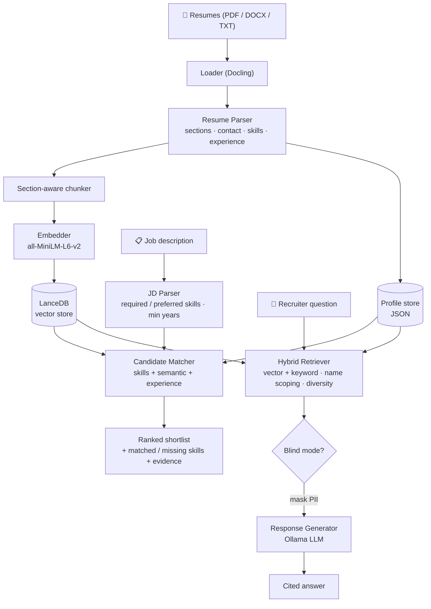

# 🧑‍💼 RecruitRAG — Resume Q&A and Explainable Candidate Matching

A fully local **Retrieval-Augmented Generation** system for recruiters. Upload resumes, **ask questions in natural language** ("Who has Kubernetes and Terraform experience?"), and **rank candidates against a job description** with transparent, explainable scores — with an optional **blind-screening mode** that masks personal identifiers.

> Built by extending a modular open-source RAG pipeline ([Pixegami's *Simple RAG Pipeline*](https://github.com/pixegami)) with a resume-specific parser, hybrid retrieval, a job-matching engine, privacy controls, and a retrieval evaluation harness.

---

## ✨ Features

| Feature | What it does |
|---|---|
| **Resume parsing** | PDF/DOCX (via Docling) and TXT/MD → sections, name, email, phone, skills, education, and **years of experience computed from date ranges** (overlaps merged, education excluded) |
| **Section-aware chunking** | Each chunk is tagged `Candidate | Section`, so retrieved text is self-describing and cites cleanly |
| **Hybrid retrieval** | Vector similarity (MiniLM) + keyword overlap, **name-aware scoping** ("What are Priya's skills?") and **per-candidate diversity** so one resume can't crowd out the rest |
| **Recruiter chatbot** | Answers grounded only in retrieved chunks, with candidate citations and a "not found" fallback instead of hallucination |
| **JD → candidate ranking** | `score = 0.5·skill coverage + 0.3·semantic similarity + 0.2·experience fit`, with matched / missing skills and evidence snippets |
| **Blind screening** | Masks names, emails, phones, links — *before* anything is displayed or sent to the LLM |
| **Fairness guardrails** | System prompts forbid inferring or ranking by protected attributes; match explanations are generated from structured facts only |
| **Evaluation** | Hit@k, Recall@k and MRR on a labelled question set (free, deterministic) + optional LLM-as-judge |
| **Two interfaces** | CLI (scriptable, `--json` output for ATS integration) and Streamlit web app |

## 🏗️ Architecture



Components follow the original pipeline's interface pattern (`Indexer`, `Datastore`, `Retriever`, `ResponseGenerator`, `Evaluator`) so any of them can be swapped.

## 🚀 Quick start

```bash
python -m venv .venv && source .venv/bin/activate     # Windows: .venv\Scripts\activate
pip install -r requirements.txt

# local LLM (a 3B+ model follows citation rules much better than a 1B model)
ollama pull llama3.2:3b
export RECRUIT_RAG_MODEL=llama3.2:3b                  # Windows: set RECRUIT_RAG_MODEL=llama3.2:3b

python main.py reset
python main.py add -p sample_data/resumes             # or your own folder
python main.py profiles
python main.py query "Who has experience with Kubernetes and Terraform?"
python main.py query "Summarise Priya's background" --anonymize
python main.py match -j sample_data/jobs/ml_engineer_llm.txt --top 5 --explain
python main.py match -j sample_data/jobs/backend_engineer.txt --json   # for integrations
python main.py evaluate -k 3                          # Hit@k / Recall@k / MRR

streamlit run app.py                                  # web UI
```

## 📊 Evaluation

`sample_data/eval/sample_questions.json` holds questions labelled with the candidates that *should* be retrieved. `python main.py evaluate` reports **Hit@k, Recall@k and MRR**, so retrieval changes (chunk size, embedding model, hybrid weight) can be compared objectively. Add `--llm-judge` to also grade generated answers.

Run the unit tests (no model download needed — they use a deterministic hashing embedder):

```bash
python -m unittest discover -s tests -v
```

## 🧩 Design decisions

- **Rule-based parsing, not LLM extraction.** Deterministic, free, auditable and unit-testable. An LLM extraction pass can be layered on for messy layouts.
- **Experience is computed, not trusted.** Date ranges are merged so overlapping jobs aren't double-counted and degree years are excluded; year-only dates are treated as mid-year to avoid overstating tenure.
- **Explainable scoring over a single opaque number.** Recruiters see *why* someone ranked where they did and which required skills are missing.
- **Privacy by design.** Resumes are processed locally; blind mode masks PII before the LLM sees it.
- **Idempotent indexing.** Re-adding a resume replaces its old chunks (no stale data).

## ⚠️ Limitations (read before using on real hiring decisions)

- Scores are **decision support, not decisions** — a human must review every shortlist. Automated hiring tools can encode bias and are regulated in some jurisdictions (e.g. NYC Local Law 144, EU AI Act).
- Blind mode masks names, contact details and links, but **not** every indirect identifier (gendered pronouns, school names, graduation years).
- The skill taxonomy (`src/util/skills.py`) is a curated list; unlisted skills are invisible to skill scoring. Extend it for your domain.
- Semantic-score calibration (`SEM_LOW/SEM_HIGH` in `matcher.py`) is tuned for MiniLM; recalibrate if you change the embedding model.
- Heavily designed/multi-column PDFs may parse imperfectly.
- Sample resumes are **fictional**. Never commit real resumes (see `.gitignore`).

## 🔭 Future scope

- ATS / CRM integration (webhook or REST endpoint wrapping `match --json`)
- LLM-assisted extraction for non-standard resume layouts; OCR for scanned PDFs
- Cross-encoder re-ranking; skill-ontology expansion (e.g. "k8s" ↔ "container orchestration")
- Multi-turn chat memory and query rewriting
- Bias audit report (score distributions across anonymised cohorts)

## 🙏 Acknowledgements

Based on the open-source **Simple RAG Pipeline** by Pixegami. Uses LanceDB, Sentence-Transformers, Docling and Ollama.
