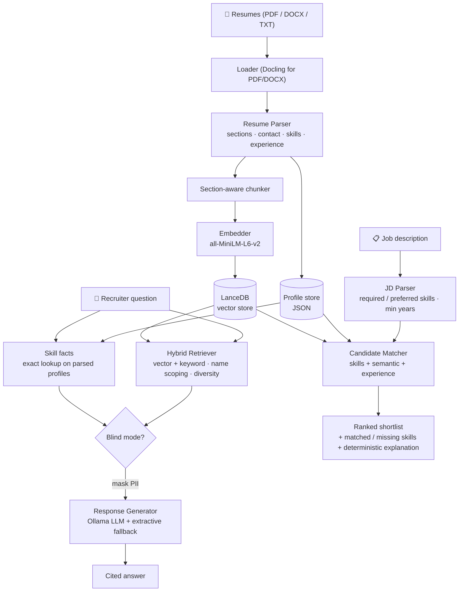

# 🧑‍💼 RecruitRAG — Resume Q&A and Explainable Candidate Matching

A fully **local** Retrieval-Augmented Generation system for recruiters. Index resumes, **ask questions in natural language** ("Who has Kubernetes and Terraform experience?"), and **rank candidates against a job description** with transparent, explainable scores. An optional **blind-screening mode** masks personal identifiers before anything is displayed or sent to the LLM.

>Architecture adapted from the modular RAG pipeline pattern (Indexer / Datastore / Retriever / ResponseGenerator / Evaluator) in Pixegami’s open-source tutorial project (no license file found). The resume parser, hybrid retriever, candidate matcher, blind-screening mode, Streamlit UI and tests are original to this project. ([Pixegami's *Simple RAG Pipeline*](https://github.com/pixegami)) 

---

## ✨ Features

| Feature | What it does |
|---|---|
| **Resume parsing** | PDF (tested) and DOCX via Docling, plus TXT/MD → sections, name, email, phone, skills, education, and **years of experience computed from date ranges** (overlaps merged, education excluded) |
| **Section-aware chunking** | Every chunk is tagged `Candidate \| Section`, so retrieved text is self-describing and citable |
| **Hybrid retrieval** | Vector similarity (MiniLM) + keyword overlap, **name-aware scoping** ("What are Priya's skills?") and **per-candidate diversity** |
| **Live recruiter Q&A** | Ask anything; a local LLM (Ollama) answers from retrieved resume text. Skill questions are first resolved **exactly from parsed profiles** and passed to the LLM as reliable facts; if a small model returns nothing usable, the answer falls back to those facts |
| **JD → candidate ranking** | `score = 0.5·skill coverage + 0.3·semantic similarity + 0.2·experience fit`, with matched/missing skills and evidence. Explanations are **deterministic** (no hallucination); `--llm-explain` is optional |
| **Blind screening** | Masks names, emails, phones, links before display and before LLM calls |
| **Fairness guardrails** | Prompts forbid inferring or ranking by protected attributes |
| **Evaluation** | Hit@k, Recall@k, MRR on a labelled question set + a `calibrate` command for the semantic-score scale |
| **Interfaces** | CLI (`--json` output for integrations) and a Streamlit web app (chat, JD matching, profiles) |

## 🏗️ Architecture



## 🚀 Quick start

```bash
python -m venv .venv && source .venv/bin/activate     # Windows Git Bash: source .venv/Scripts/activate
pip install -r requirements.txt

ollama pull gemma3:1b            # small default; a 3B+ model (e.g. llama3.2:3b) answers better
# optional: export RECRUIT_RAG_MODEL=llama3.2:3b

python main.py reset
python main.py add -p sample_data/resumes             # or a folder / file of your own resumes (.pdf .docx .txt .md)
python main.py profiles
python main.py query "Who has experience with Kubernetes and Terraform?"
python main.py query "Summarise Priya's background" --anonymize
python main.py match -j sample_data/jobs/ml_engineer_llm.txt --explain
python main.py match -j sample_data/jobs/backend_engineer.txt --json
python main.py calibrate -j sample_data/jobs/ml_engineer_llm.txt   # raw semantic scores
python main.py evaluate -k 3

streamlit run app.py             # web UI at http://localhost:8501
```

## 🖥️ Tested on (low-resource hardware)

Developed and run on a **Windows laptop with 4 GB RAM** (virtual memory extended), Python 3.12, Ollama with `gemma3:1b` and `all-MiniLM-L6-v2` embeddings. Tips for small machines:

- Close other apps before running; first `import torch` can take minutes.
- Run commands one at a time. The Streamlit app loads models **once** and keeps them cached, so it is faster than repeated CLI calls.
- The first LLM answer is slow while Ollama loads the model.
- `HF_HUB_OFFLINE=1` skips network checks once models are downloaded (leave it unset the first time Docling downloads its models).
- Docling is only needed for PDF/DOCX; TXT/MD resumes work without it.

## 📊 Evaluation

`sample_data/eval/sample_questions.json` labels which candidates *should* be retrieved for each question. `python main.py evaluate` reports **Hit@k, Recall@k, MRR**. The bundled set is small and synthetic (8 easy queries), so it validates the plumbing rather than real-world accuracy; add harder, paraphrased and no-match questions before drawing conclusions.

Unit tests (no model download needed; they use a deterministic hashing embedder):

```bash
python -m unittest discover -s tests -v
```

## 🧩 Design decisions

- **Rule-based parsing, not LLM extraction:** deterministic, free, auditable, unit-testable.
- **Experience is computed, not trusted:** merged date ranges; year-only dates treated as mid-year.
- **Deterministic explanations:** a 1B local model contradicted the computed scores in free-text summaries (e.g. praising a skill the candidate lacked), so explanations are generated from the numbers; LLM prose is opt-in.
- **Structured facts + retrieval:** exact skill lookups on parsed profiles back up the LLM, with an extractive fallback when the model returns junk.
- **JD embedding uses requirements only:** company-blurb text no longer attracts unrelated resumes.
- **Privacy by design:** local processing; blind mode masks PII before the LLM sees it.
- **Idempotent indexing:** re-adding a resume replaces its old chunks.

## ⚠️ Limitations

- Scores are **decision support, not decisions**; a human must review shortlists. Automated hiring tools can encode bias and are regulated in some jurisdictions (e.g. NYC Local Law 144, EU AI Act).
- Blind mode masks names, contact details and links, **not** every indirect identifier (pronouns, school names, graduation years).
- The skill taxonomy (`src/util/skills.py`) is curated; unlisted skills are invisible to skill scoring.
- Semantic scale (`SEM_LOW/SEM_HIGH` in `matcher.py`) was set from a small sample; re-run `calibrate` for new embedding models or larger pools.
- Small local LLMs give plain answers; the structured-facts layer keeps skill lookups correct.
- Complex multi-column PDFs may parse imperfectly.
- Sample resumes are **fictional**. Never commit real resumes (see `.gitignore`).

## 🔭 Future scope

- REST API (FastAPI) wrapping `match --json` for ATS/CRM integration
- LLM-assisted extraction for odd layouts; OCR for scanned PDFs
- Cross-encoder re-ranking and skill-ontology expansion
- Multi-turn chat memory; bias-audit reporting

## 🙏 Acknowledgements

Based on the open-source **Simple RAG Pipeline** by Pixegami. Uses LanceDB, Sentence-Transformers, Docling, Ollama and Streamlit.
